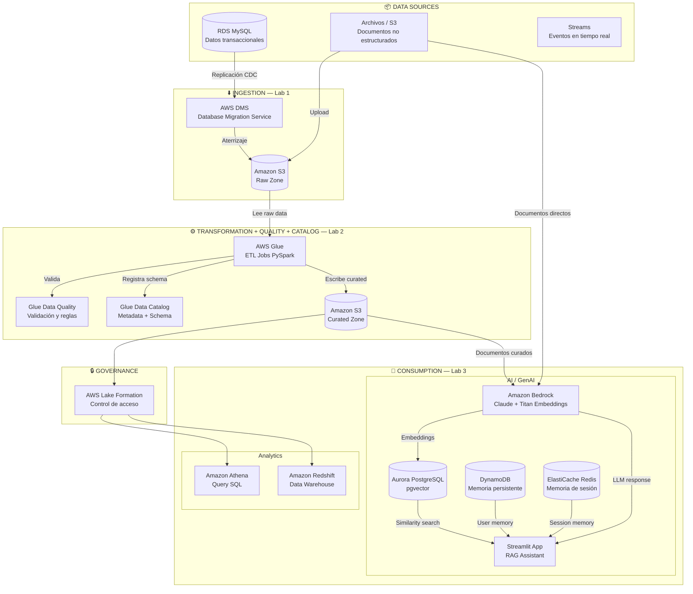
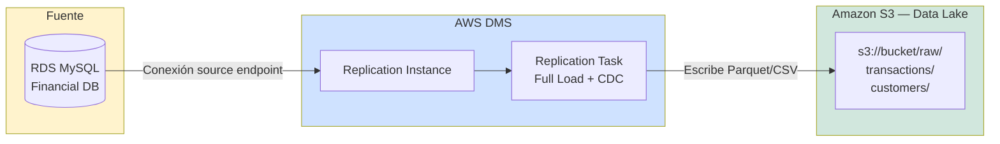
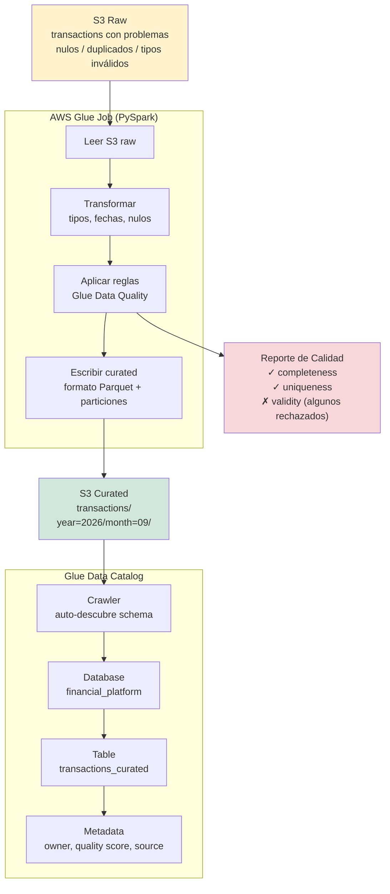
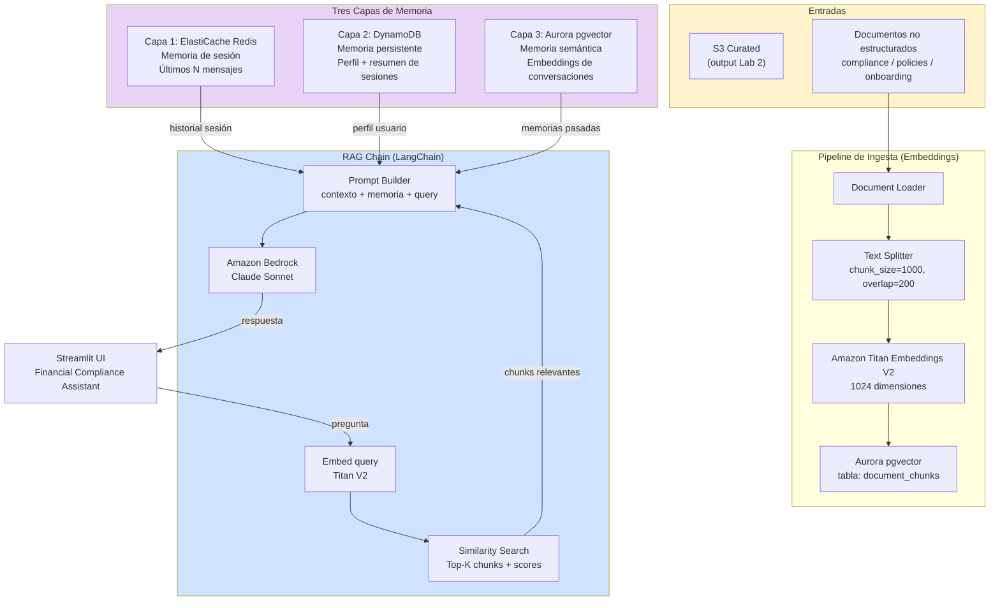
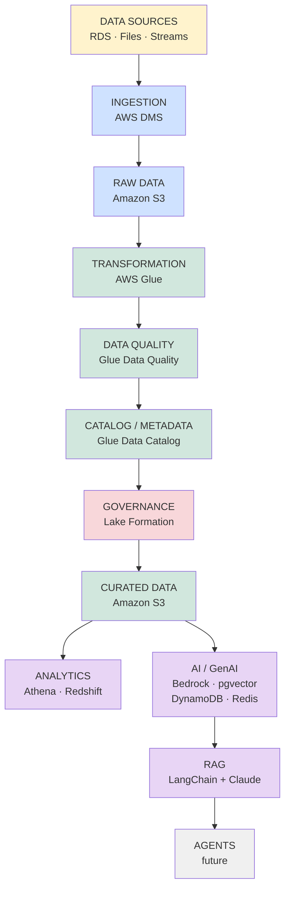

# ARCHITECTURE — Data Platform for AI en AWS

> Este documento describe la arquitectura **implementada**. Para componentes en
> evaluación y no construidos, ver
> [architecture-demo-proposal.md](architecture-demo-proposal.md).

> Arquitectura completa de la charla "De los Datos a la IA"  
> Ver `docs/STRATEGY.md` para el contexto narrativo

---

## Arquitectura completa de la plataforma

---

## Arquitectura por lab

### Lab 1 — Ingestion + Data Lake

**Componentes del Lab 1:**
| Recurso | Tipo | Propósito | Costo estimado demo |
|---------|------|-----------|---------------------|
| RDS MySQL db.t3.micro | EC2 | Fuente de datos transaccional | ~$0.02/hr |
| DMS Replication Instance dms.t3.medium | Managed | Motor de replicación | ~$0.07/hr |
| S3 bucket | Object Storage | Raw zone del Data Lake | <$0.01 |
| Secrets Manager | Managed | Credenciales RDS | $0.01/hr |

---

### Lab 2 — Transformation + Quality + Catalog

**Problemas deliberados en el dataset (para demostrar Data Quality):**
- `amount = NULL` en ~5% de transacciones
- `customer_id` duplicado en ~3% de registros
- `transaction_date` en formato incorrecto (`DD/MM/YYYY` vs `YYYY-MM-DD`)
- `transaction_type` con valores no válidos (`'DEPÓSITO'` vs `'DEPOSIT'`)
- `status` con inconsistencias de case (`'pending'` / `'PENDING'` / `'Pending'`)

---

### Lab 3 — Data to AI

---

## Arquitectura de reveal final (slide de cierre)

---

## Mapa de servicios AWS

| Capa | Servicio | Rol en la plataforma |
|------|----------|---------------------|
| Ingestion | AWS DMS | Replica datos de RDS → S3 con CDC |
| Storage | Amazon S3 | Raw zone + Curated zone del Data Lake |
| Transformation | AWS Glue (PySpark) | ETL: raw → limpio → curated |
| Data Quality | Glue Data Quality | Validación con ruleset declarativo |
| Catalog | Glue Data Catalog | Schema, metadata, business context |
| Governance | AWS Lake Formation | Control de acceso a nivel tabla/columna |
| Analytics | Amazon Athena | SQL serverless sobre S3 curated |
| Vector Store | Aurora PostgreSQL + pgvector | Embeddings de documentos y memorias |
| Session Memory | Amazon ElastiCache Redis | Últimos N mensajes de la sesión |
| Persistent Memory | Amazon DynamoDB | Perfil y resumen de usuario |
| LLM + Embeddings | Amazon Bedrock | Claude (generación) + Titan (embeddings) |

> **Principio de inclusión**: cada servicio aparece porque resuelve un problema demostrado en el lab, no porque sea un servicio interesante de explicar.

---

## Relación con la arquitectura de la charla 2025 (v1.0.0)

El código heredado de 2025 implementa el Lab 3 completo, y hoy vive en
`labs/03-data-to-ai/`:

| Módulo (2025) | Rol en la nueva arquitectura |
|---------------|------------------------------|
| `labs/03-data-to-ai/ingestion/` | Pipeline de embeddings → Lab 3 |
| `labs/03-data-to-ai/query/` | RAG chain + 3 capas de memoria → Lab 3 |
| `labs/03-data-to-ai/app/app.py` | Streamlit UI → Lab 3 |
| `labs/03-data-to-ai/data/` | Corpus de documentos → Lab 3 |
| `infra/lab3/` | Base para extender con Lab 1 y 2 |

El código **no se elimina ni se duplica**: es el Lab 3, y vive en
`labs/03-data-to-ai/`. El repositorio de 2025 íntegro sigue accesible en el tag
`v1.0.0`.

---

*Ver `docs/DESIGN.md` para las decisiones de diseño específicas por lab.*
